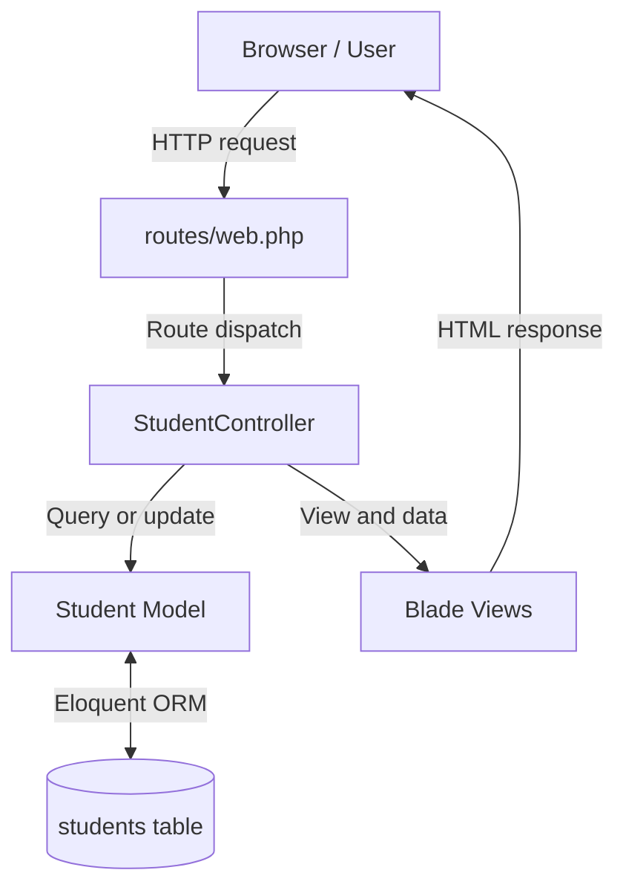

# Laravel MVC Architecture

## Request lifecycle
1. The browser sends a request to a student URL.
2. `routes/web.php` matches the URL and HTTP method.
3. `StudentController` validates input and coordinates the operation.
4. The `Student` model reads or writes data using Eloquent.
5. The controller returns a Blade view or redirects.
6. The browser displays the response.

## MVC responsibilities
- **Model:** `app/Models/Student.php` represents a student and its database table.
- **View:** `resources/views/students/` contains the user-facing pages.
- **Controller:** `StudentController.php` handles requests, validation, and CRUD operations.
